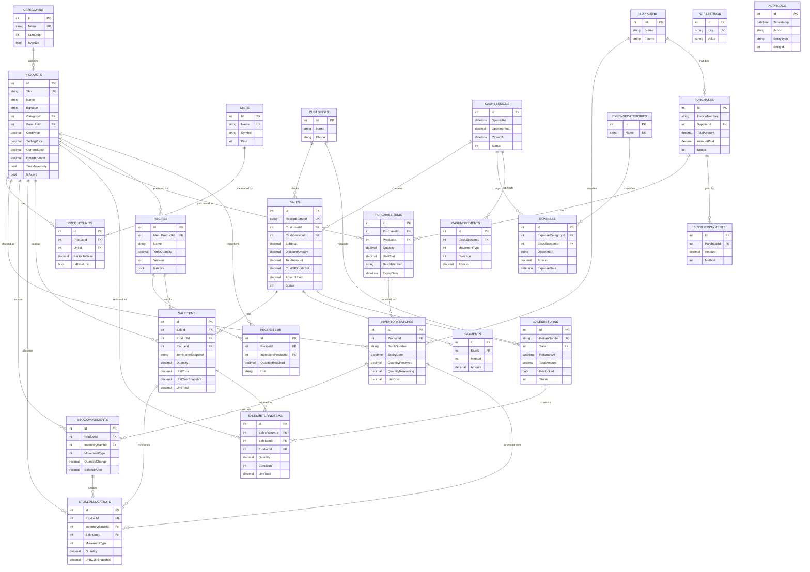

# ER Diagram — Highland Milk Bar Management System

The diagram below reflects the EF Core model (`AppDbContext` + configurations). Attribute lists
are abbreviated to key columns; see `DATABASE_DICTIONARY.md` for the full column list.

